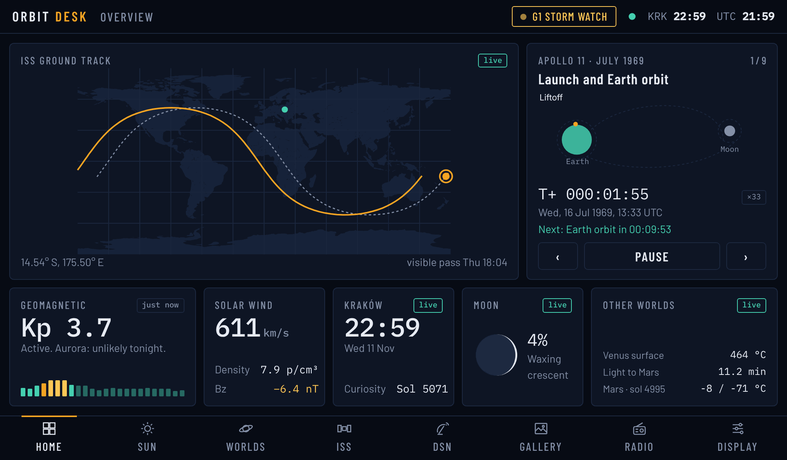
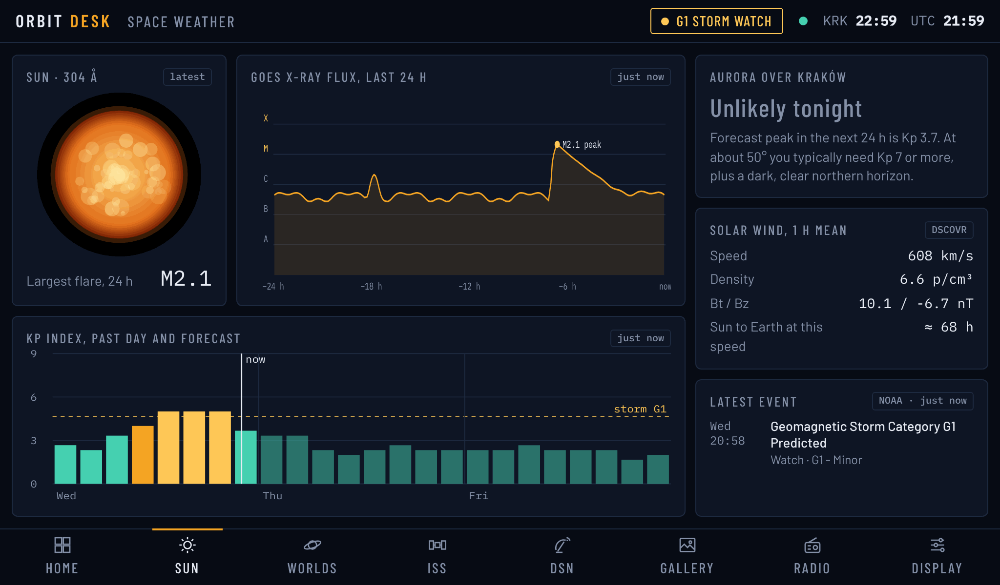
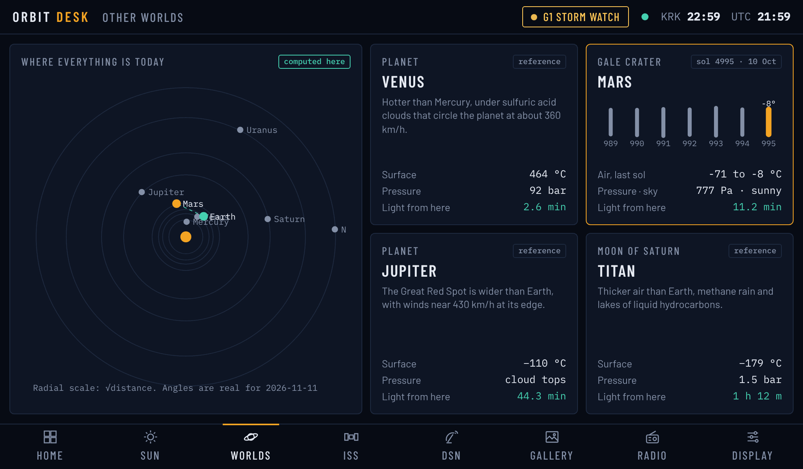
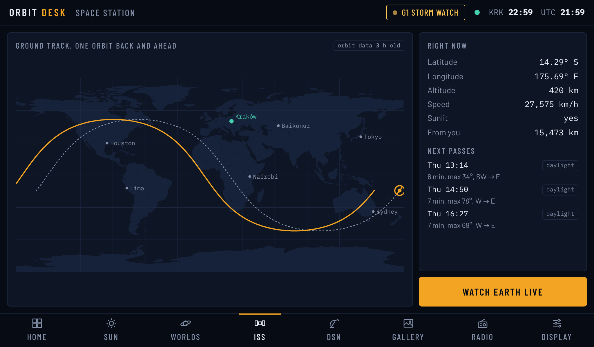
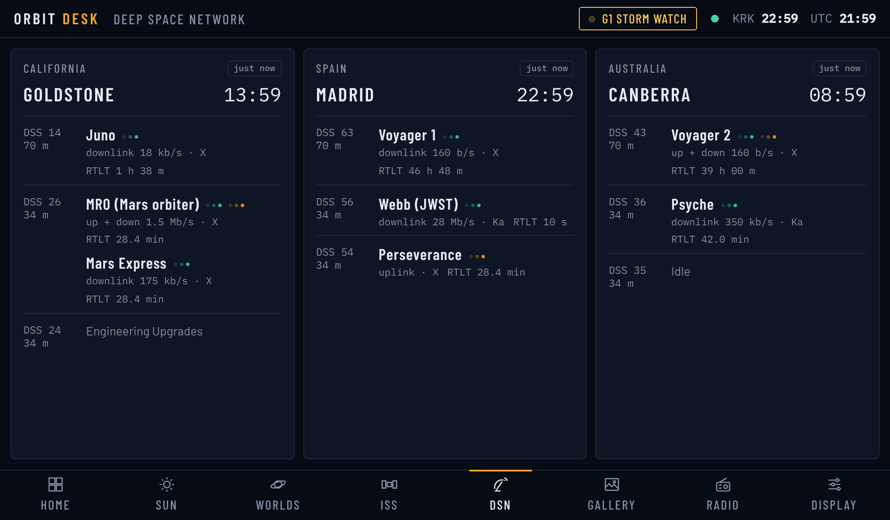
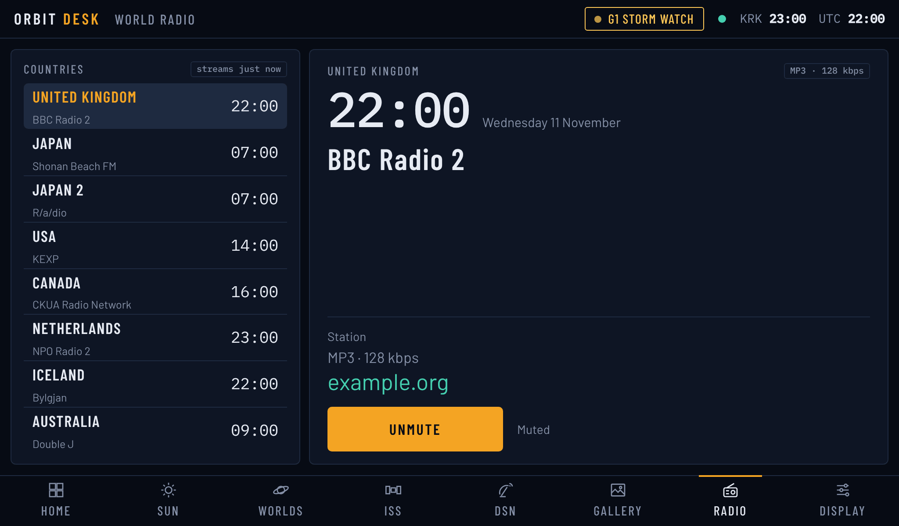
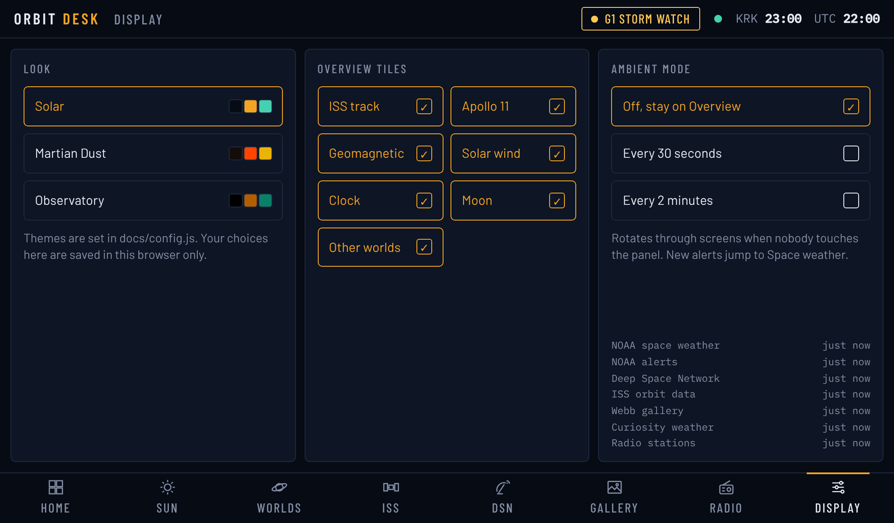
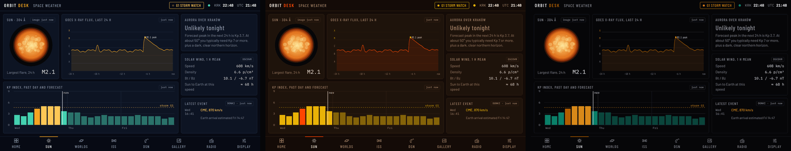

<div align="center">

# 🛰️ Orbit Desk

**A live space dashboard: space weather, the ISS, NASA's Deep Space Network, the planets and Webb pictures on one screen.**

A plain static website: no build step, no API keys, no backend. It also runs on a Raspberry Pi with a 7″ touch screen.




</div>

---

## Contents

- [What's on it](#whats-on-it)
- [Try it on your computer](#try-it-on-your-computer)
- [Put it on GitHub Pages](#put-it-on-github-pages)
- [Change the settings](#change-the-settings)
- [Run it on a Raspberry Pi](#run-it-on-a-raspberry-pi)
- [How it works](#how-it-works)
- [Data sources](#data-sources)
- [Project layout](#project-layout)
- [Known limits](#known-limits)
- [Troubleshooting](#troubleshooting)
- [Credits](#credits)

## What's on it

Eight screens, drawn at 1024×600 and scaled to fit any window.

| Screen | What it shows | Where the data comes from |
|---|---|---|
| **Overview** | Large ISS map, an Apollo 11 mission replay, Kp, solar wind, local clock, Moon phase, other worlds | Everything below. The clock, Moon and Apollo replay are computed in the page |
| **Space weather** | Sun image, X-ray flares (24 h), Kp past and forecast, chance of aurora where you are, solar wind, latest NOAA alert | NOAA Space Weather Prediction Center, NASA SDO |
| **Other worlds** | Where the planets are today, light time from Earth, conditions on Venus, Jupiter and Titan, Curiosity's weather in Gale crater | Positions computed in the page from JPL orbital elements. Mars weather from NASA's REMS feed |
| **ISS** | Live position, ground track one orbit back and ahead, next passes over you (visible ones marked), live Earth view | CelesTrak orbital elements, propagated in the browser with SGP4 |
| **DSN** | Which antenna talks to which spacecraft, data rate, round-trip light time | JPL DSN Now |
| **Gallery** | A random Webb picture every 15 min, the Astronomy Picture of the Day | NASA Image and Video Library, APOD |
| **Radio** | One station per country with its local time. Audio keeps playing on other screens | radio-browser.info |
| **Display** | Theme, which overview tiles to show, ambient rotation through screens, feed health | Saved in your browser |

A banner appears in the status bar during a geomagnetic storm (G1+), a radio blackout from a flare (R1+), or after a fresh NOAA watch or warning. When a new one appears, the panel jumps to Space weather.

<table>
  <tr>
    <td></td>
    <td></td>
  </tr>
  <tr>
    <td align="center"><b>Space weather</b></td>
    <td align="center"><b>Other worlds</b></td>
  </tr>
  <tr>
    <td></td>
    <td></td>
  </tr>
  <tr>
    <td align="center"><b>ISS</b></td>
    <td align="center"><b>Deep Space Network</b></td>
  </tr>
  <tr>
    <td></td>
    <td></td>
  </tr>
  <tr>
    <td align="center"><b>World radio</b></td>
    <td align="center"><b>Display settings</b></td>
  </tr>
</table>

Themes are set in `docs/config.js`. These are Solar, Martian Dust and Observatory:



<sub>Screenshots use sample data.</sub>

## Try it on your computer

The whole website is the `docs/` folder. Serve it with any static web server. Python's built-in one works:

```bash
cd orbit-desk
python3 -m http.server -d docs 8000
```

Open <http://localhost:8000>. Nothing to install, and no keys.

> [!TIP]
> Use a server like the one above, not a double-click on `index.html`. Some browsers block a page opened from a file from fetching data.

The **Display** screen lists every feed with its age. Hover over a red one to see why it failed.

## Put it on GitHub Pages

1. **Create a repository.** On GitHub click **New repository**, make it **public**, and leave it empty (no README or license).
2. **Push this folder,** using the repository URL GitHub shows you:
   ```bash
   cd orbit-desk
   git init -b main
   git add .
   git commit -m "Orbit Desk"
   git remote add origin <your repository URL>
   git push -u origin main
   ```
3. **Turn on Pages.** Go to **Settings → Pages**. Under **Build and deployment** choose **Source: Deploy from a branch**, then **Branch: `main`** and folder **`/docs`**, and click **Save**.

After a minute the site is live. Its address appears at the top of **Settings → Pages**.

There is nothing else to set up. Each visitor's browser fetches the feeds directly. To change the site, edit files and push. GitHub republishes it automatically.

## Change the settings

Edit **`docs/config.js`**. Each setting has a comment.

| Setting | What it does |
|---|---|
| `location` | Your place: the clock, ISS passes over you, and the aurora verdict |
| `aurora_kp_threshold` | Kp usually needed to see aurora from your latitude (about 7 for southern Poland) |
| `iss_stream_url` | Embeddable live Earth-view stream for **Watch Earth live**, e.g. `https://www.youtube.com/embed/VIDEO_ID?autoplay=1&mute=1` |
| `gallery` | Searches for the Webb picture pool, and how often the picture changes |
| `radio` | One station per row. `search` is looked up in radio-browser.info, and `url` pins an exact stream |
| `themes` | Colour themes listed under Display → Look |
| `site.repo_url` | Optional. Makes the **Orbit Desk** logo link to your repository |

Choices made on the **Display** screen (theme, tiles, ambient mode, radio station) are saved in each visitor's own browser.

## Run it on a Raspberry Pi

There are two options.

**Option A: show the website.** Open your GitHub Pages address in Chromium in kiosk mode, with `?kiosk` added to the end of the address to hide the mouse pointer. Nothing to install.

**Option B: run the included Python server** for a few extras the browser can't do:

| | Website | Pi server |
|---|---|---|
| Space weather, ISS, pictures, radio | ✓ | ✓ |
| Deep Space Network | If NASA allows browsers to read it (see [Known limits](#known-limits)) | ✓ live, every 10 s |
| NASA DONKI flares, CMEs and storms | NOAA alerts instead | ✓ (needs a free NASA key) |
| Song titles on the radio screen | – | ✓ |
| Keeps the last data when the Wi-Fi drops | Partly (per browser) | ✓ |

The server serves the same `docs/` page, which notices the server and uses it.

<details>
<summary><b>Install the Pi server</b></summary>

Made for a Raspberry Pi 4 with a 7″ 1024×600 HDMI touch screen.

1. Flash **Raspberry Pi OS with desktop (64-bit)** with Raspberry Pi Imager. In the Imager settings, set your Wi-Fi and user name and enable SSH.
2. Plug in the screen (HDMI, plus USB for touch) and boot. Check that the desktop fills the screen.
3. On the Pi:
   ```bash
   git clone <your repository URL> ~/orbit-desk
   cd ~/orbit-desk
   ./deploy/install.sh
   nano config.local.toml   # optional: your NASA key from https://api.nasa.gov
   sudo reboot
   ```

After the reboot the panel opens full screen by itself.

The installer:
- creates a Python virtual environment in `.venv`
- installs the server as the `orbitdesk` systemd service
- opens Chromium in kiosk mode at login
- turns off screen blanking

The Pi reads its settings from `config.toml`, not `docs/config.js`. `config.example.toml` explains every key. Private settings, such as the NASA key, go in `config.local.toml`, which git ignores.

```bash
systemctl status orbitdesk          # is the server running?
journalctl -u orbitdesk -f          # live logs
sudo systemctl restart orbitdesk    # after editing config.toml
git pull && sudo systemctl restart orbitdesk   # update
```

To leave kiosk mode, plug in a keyboard and press Alt+F4. To stop it opening at login, remove `~/.config/autostart/orbitdesk-kiosk.desktop`.

To try the server on a laptop:

```bash
python3 -m venv .venv && . .venv/bin/activate
pip install -r requirements.txt
python -m orbitdesk --demo     # sample data; drop --demo for live feeds
# open http://localhost:8321
```

</details>

## How it works

```
docs/
  index.html  app.css  app.js   the panel: screens, charts, maps, the Apollo replay
  web.js                        fetches and parses every feed in the browser
  config.js                     your settings for the website
  vendor/  fonts/               satellite.js, hls.js and fonts, so nothing comes from a CDN
```

- When the page starts, it checks for a Raspberry Pi server. On GitHub Pages there isn't one, so `web.js` fetches each feed straight from its source and parses it.
- Every result is kept in the browser's `localStorage`. A reload doesn't fetch again before a feed is due, and a feed that fails keeps showing its last good copy, marked stale.
- Feeds are fetched no more often than they change: space weather every 2–30 min, ISS orbit data every 6 h, Mars weather every 6 h, the picture pool every 12 h. This is gentle on the services.
- The ISS position, ground track and pass predictions are computed in the browser with [satellite.js](https://github.com/shashwatak/satellite-js) (SGP4). They match the Pi's Skyfield results to within a fraction of a degree.
- The planets, Moon phase and Apollo 11 replay are all computed in the page and need no data at all.

## Data sources

| Source | Used for |
|---|---|
| [NOAA Space Weather Prediction Center](https://www.swpc.noaa.gov/) | Kp and forecast, GOES X-rays, real-time solar wind, alerts, SUVI Sun image |
| [NASA SDO](https://sdo.gsfc.nasa.gov/) | Sun at 304 Å |
| [CelesTrak](https://celestrak.org/) | ISS orbital elements |
| [JPL DSN Now](https://eyes.nasa.gov/apps/dsn-now/) | Deep Space Network antennas and links |
| [NASA Image and Video Library](https://images.nasa.gov/) | Webb pictures |
| [Astronomy Picture of the Day](https://science.nasa.gov/) | Picture of the day |
| [NASA Mars weather (CAB REMS)](https://mars.nasa.gov/msl/weather/) | Curiosity readings from Gale crater |
| [radio-browser.info](https://www.radio-browser.info/) | Radio stream addresses |
| [Natural Earth](https://www.naturalearthdata.com/) | Coastlines (public domain) |

None of these needs a key. The Pi server can also use [NASA DONKI](https://kauai.ccmc.gsfc.nasa.gov/DONKI/), which does.

## Project layout

```
docs/                the website (GitHub Pages publishes this folder)
  index.html, app.css, app.js, apollo.js, world.js
  web.js             browser-side feeds and parsers
  config.js          website settings
  fonts/             Barlow, Barlow Condensed, IBM Plex Mono (SIL OFL)
  vendor/            satellite.js (MIT), hls.js (Apache-2.0)
orbitdesk/           optional Raspberry Pi server (Python)
  sources/           one module per feed: fetch + parse
  app.py             JSON API + serves docs/
  jobs.py, cache.py  scheduled fetching, disk cache
  config.py          config.toml < config.local.toml < NASA_API_KEY env var
deploy/              Pi installer, kiosk launcher, autostart
tests/               parser tests on payloads copied from the live services
config.toml          Pi settings (config.example.toml explains every key)
screenshots/         images for this README
```

## Known limits

- **A browser can only read a feed whose server allows it.** If a source doesn't, its tile says so and the rest keeps working. The Deep Space Network feed is the most likely to be blocked; if it is, the DSN screen links to NASA's DSN Now instead. Curiosity's weather falls back to typical values. **Display** shows which feeds loaded.
- **No NASA DONKI on the website,** because it needs a key. The "Latest event" tile shows NOAA's latest alert, watch or warning instead.
- **No song titles on the radio screen.** They're sent inside the audio stream, where browsers can't read them. The website shows the station's homepage instead.
- **Some radio stations won't play** if they only stream over plain `http://`, which browsers block on an `https://` page. The page tries `https://` first. If a station still fails, pick another in `docs/config.js`.
- **ISS passes are for the location in `config.js`,** not for each visitor.
- **On a phone held upright the panel is small.** It is a 1024×600 landscape layout, so turn the phone sideways.
- **Mars weather runs about a month behind.** Curiosity's readings are processed before release. The card shows the sol and its Earth date.
- **The SDO Sun image sometimes lags by days.** If it doesn't load, the page uses NOAA's SUVI image.

## Troubleshooting

- **Blank page or "Waiting for data" everywhere:** serve the folder (see [Try it on your computer](#try-it-on-your-computer)) instead of opening the file directly, and check that you're online.
- **A tile says "stale" or a feed is red under Display:** hover over the feed name to see the error. "Blocked" means that source doesn't allow browsers to read it.
- **Settings or data look old after you changed `config.js`:** reload the page. GitHub Pages can cache files for up to 10 minutes.
- **404 on GitHub Pages:** check **Settings → Pages**: the branch should be `main` and the folder `/docs`.
- **Start fresh in the browser:** open the developer console and run `localStorage.clear()`, then reload.

## Credits

- Data from NOAA, NASA (SDO, Image and Video Library, APOD, Mars weather), JPL, CelesTrak, Centro de Astrobiología (CSIC-INTA) and radio-browser.info.
- Coastlines from [Natural Earth](https://www.naturalearthdata.com/) (public domain).
- [satellite.js](https://github.com/shashwatak/satellite-js) (MIT) and [hls.js](https://github.com/video-dev/hls.js) (Apache-2.0). Their licenses are in `docs/vendor/`.
- [Barlow](https://github.com/jpt/barlow) and [IBM Plex Mono](https://github.com/IBM/plex) fonts (SIL Open Font License). Their licenses are in `docs/fonts/`.

Orbit Desk is a personal project and is not affiliated with NASA, NOAA or JPL.

## License

MIT. See [LICENSE](LICENSE). The bundled libraries and fonts keep their own licenses, listed above.
